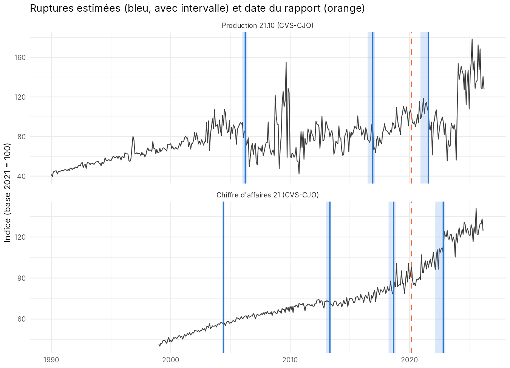
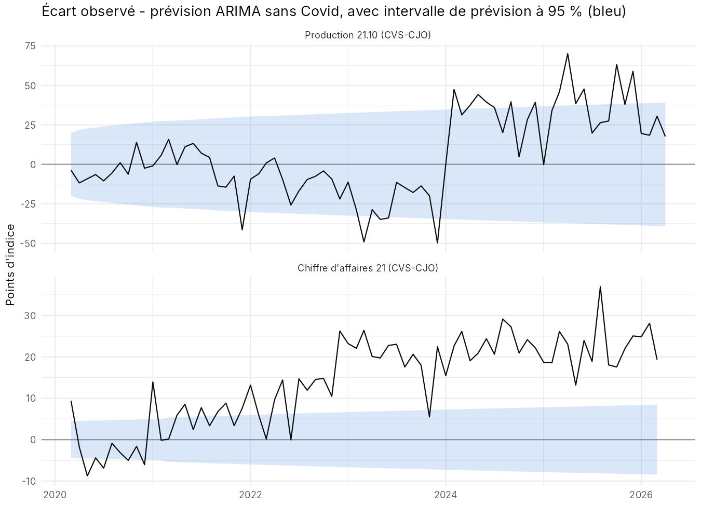

# Mesurer l'effet d'un choc de demande sur un secteur : le cas de la pharmacie de base (NAF 21.10)

**En une phrase :** quand la demande d'un secteur change brutalement, un décideur doit séparer ce qui relève du choc de ce qui relevait déjà de la tendance. Cette étude confronte trois approches de séries temporelles (régression à variable indicatrice, ARIMA contrefactuel, ARIMAX) sur les indices INSEE de **production industrielle** et de **chiffre d'affaires** de la fabrication de produits pharmaceutiques de base autour de la crise Covid-19, puis **teste la solidité de ses propres conclusions** (ruptures estimées, tests placebo, erreurs-types robustes, comparaison hors échantillon).

| | |
|---|---|
| **Données** | INSEE, séries mensuelles CVS-CJO : IPI 21.10 (1990-01 → 2026-04), indice de chiffre d'affaires de l'industrie pharmaceutique (1999-01 → 2026-03). Voir `data/README.md` (non incluses). |
| **Outils** | R 4.3 : `tidyverse`, `forecast`, `tseries`, `strucchange`, `sandwich`, `lmtest`, `zoo`, `lubridate`, `moments`, `knitr`, `kableExtra` |
| **Méthodes** | STL, test ADF, régression avec indicatrice, `auto.arima` + prévision contrefactuelle, ARIMAX, ruptures de Bai-Perron, placebos, validation à origine glissante, erreurs-types de Newey-West |
| **Livrables** | `R/` (3 scripts, exécutés de bout en bout), `report/` (rapport de 21 pages), `figures/` (14 figures), `outputs/` (tables de résultats CSV) |

## 1. Les chiffres du rapport sont reproduits

Les scripts ont été exécutés sur les données INSEE : tous les chiffres du rapport sont retrouvés à l'identique (ADF −3,14, p = 0,098 / −0,55, p = 0,979 ; coefficient Covid 12,00 et 18,43 ; R² 0,553 et 0,938 ; ARIMA(1,1,1)(0,0,2)[12] et (0,1,1)(0,0,1)[12] ; écarts contrefactuels 5,84 et 14,03 ; AIC/BIC/RMSE des tableaux 5 et 6). Le travail est donc exact **au sens du calcul**. Les sections suivantes montrent que son **interprétation** doit être nuancée.

## 2. Ce que les tests de robustesse montrent (`R/03_analyse_corrigee.R`)

| Test | Production 21.10 | Chiffre d'affaires |
|---|---|---|
| **Ruptures estimées** (Bai-Perron, BIC) | avril 2006, décembre 2016, août 2021 | juin 2004, mai 2013, **septembre 2018**, **novembre 2022** |
| **Écart au contrefactuel ARIMA**, moyenne par période | mars 2020-2021 : −2,8 · 2022-2023 : −17,9 · **2024 et après : +33,0** | mars 2020-2021 : +1,8 · 2022-2023 : +15,7 · 2024 et après : +22,5 |
| Part des mois hors de l'intervalle de prévision à 95 % | 5 % · 17 % · 46 % | 55 % · 83 % · 100 % |
| **Placebo** : même méthode avec de fausses dates de crise (écart moyen en % de la prévision) | réel +5,2 % ; placebos de −23,9 % à +8,7 % (écart-type 11,0) → **indiscernable** | réel +13,9 % ; placebos de −6,9 % à −1,5 % → **nettement au-dessus** |
| **Coefficient Covid de la régression**, erreur-type robuste (Newey-West) | 12,0 ; erreur-type 2,7 → **8,9** ; IC 95 % [−5,5 ; 29,5] (**contient 0**) | 18,4 ; erreur-type 1,1 → 4,4 ; IC 95 % [9,7 ; 27,1] |
| **Coefficient Covid de l'ARIMAX** | **−4,8** ; IC 95 % [−22,1 ; 12,5] | **−2,5** ; IC 95 % [−6,7 ; 1,8] |
| **Comparaison hors échantillon** (avant 2020, horizon 12 mois, origines glissantes depuis 2008 ; RMSE) | ARIMA 17,9 · naïf avec dérive 18,2 · tendance 18,2 · ETS 18,4 | ETS 2,97 · ARIMA 2,98 · naïf avec dérive 3,31 · tendance 3,79 |

### Ce que les données permettent d'affirmer, et ce qu'elles ne permettent pas

- **Chiffre d'affaires** : il est nettement au-dessus de sa tendance d'avant-crise (ni les erreurs-types robustes ni le test placebo ne l'effacent), mais la hausse s'accélère à partir de **septembre 2018** puis de **novembre 2022**, pas en mars 2020 : l'écart reste faible en 2020-2021. L'indice est en valeur : une part de la hausse peut venir des prix (non testé ici faute de déflateur).
- **Production** : pendant 2020-2023 elle reste, en moyenne, sous le scénario sans Covid (et dans l'intervalle de prévision pour la plupart des mois) ; l'essentiel de l'écart moyen de +5,8 vient du **saut de début 2024**, quatre ans après la date retenue. Avec des erreurs-types robustes et des placebos, **aucun effet distinct n'est démontré**.
- **Les trois méthodes ne convergent pas** : l'ARIMAX, qui estime l'effet avec une erreur-type en tenant compte de la dépendance temporelle, donne un coefficient Covid négatif et non significatif pour les deux séries. Le rapport écrit que « aucune méthode ne contredit les autres » ; ce n'est pas exact au vu de ces résultats.
- **« L'ARIMA est le meilleur modèle »** : la comparaison d'origine (AIC/BIC/RMSE) n'est pas valide, l'ARIMA étant estimé sur un échantillon plus court et différent. En prévision hors échantillon, l'avantage de l'ARIMA est minime pour la production et nul face à ETS pour le chiffre d'affaires.

## 3. Limites restantes

- La date de rupture de mars 2020 est une hypothèse de départ du rapport ; les ruptures estimées ici viennent d'un modèle simple (log, tendance par segment) et le saut de 2024 de la production, très visible, n'est pas retenu par le critère BIC à cause de la forte volatilité.
- Données agrégées : pas de déflateur de prix, pas de groupe témoin utilisable dans les modèles (les séries 21 et 21.20 ne sont que représentées graphiquement), pas de données sur les aides publiques.
- Les placebos réutilisent `auto.arima` et sont peu nombreux (12 et 11) : ils situent l'ordre de grandeur du bruit, pas une p-valeur.
- Le rapport PDF (`report/`) est conservé tel qu'il a été rendu ; ses conclusions sont à lire avec les sections 1 et 2 ci-dessus.

## Reproduction

1. Exporter les trois CSV depuis l'INSEE et les placer dans le dossier de travail (voir `data/README.md`) : `valeurs_mensuelles.csv`, `caractéristiques.csv`, `valeurs_mensuellesca.csv`.
2. Dans R, depuis ce dossier : exécuter `R/01_production.R`, puis `R/02_chiffre_affaires.R` **dans la même session** (le second réutilise des objets du premier), puis `R/03_analyse_corrigee.R` (autonome, environ 2 minutes).

`01_production.R` a été légèrement adapté pour lire l'export brut de l'INSEE (colonne de valeurs nommée par sa position, lignes d'en-tête ignorées) ; les calculs sont inchangés.

## Auteurs et contexte

Étude réalisée en binôme avec Nabil Tibouchi (Université de Caen Normandie, Master Statistiques appliquées et analyse décisionnelle, 2025-2026), encadrée par M. Bruno Dardaillon. Les tests de robustesse (section 2) ont été ajoutés après coup par Yacine Yefsah. Source des données : INSEE.
